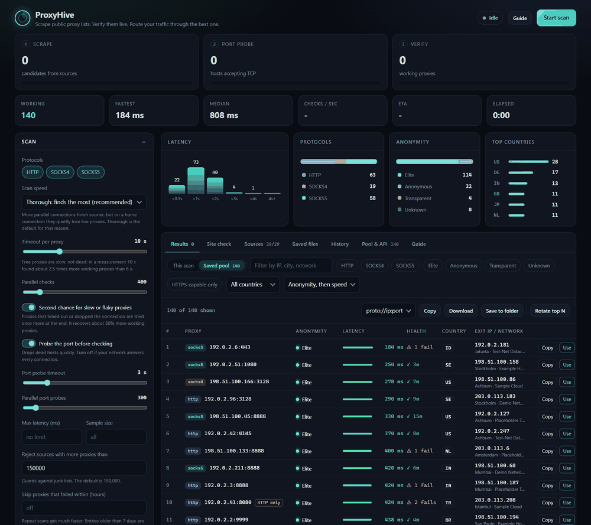
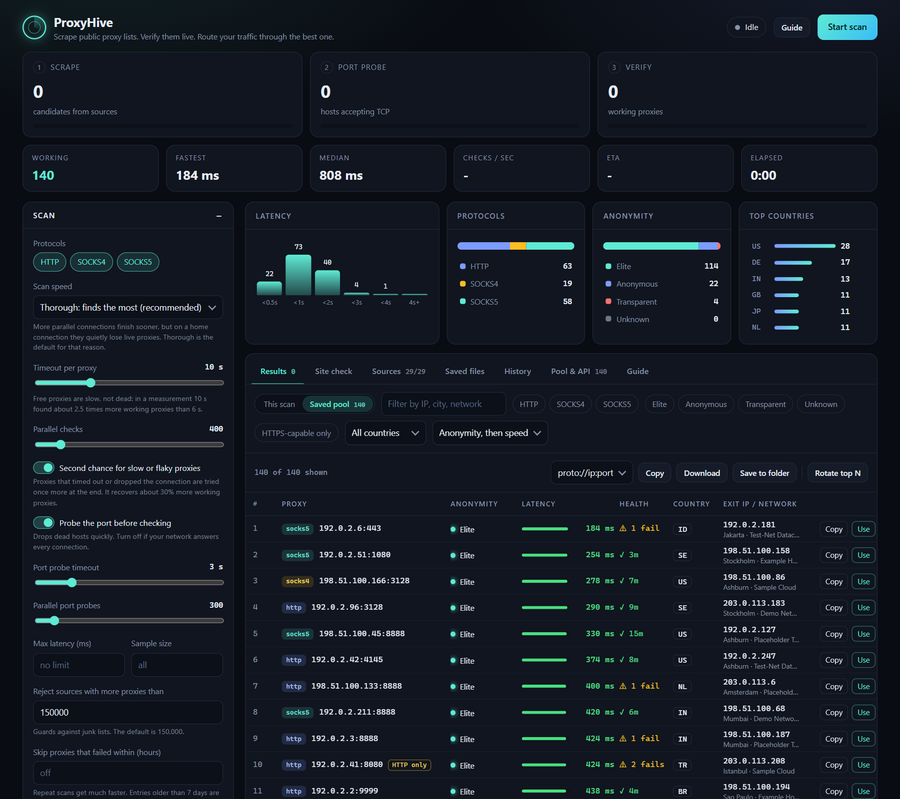
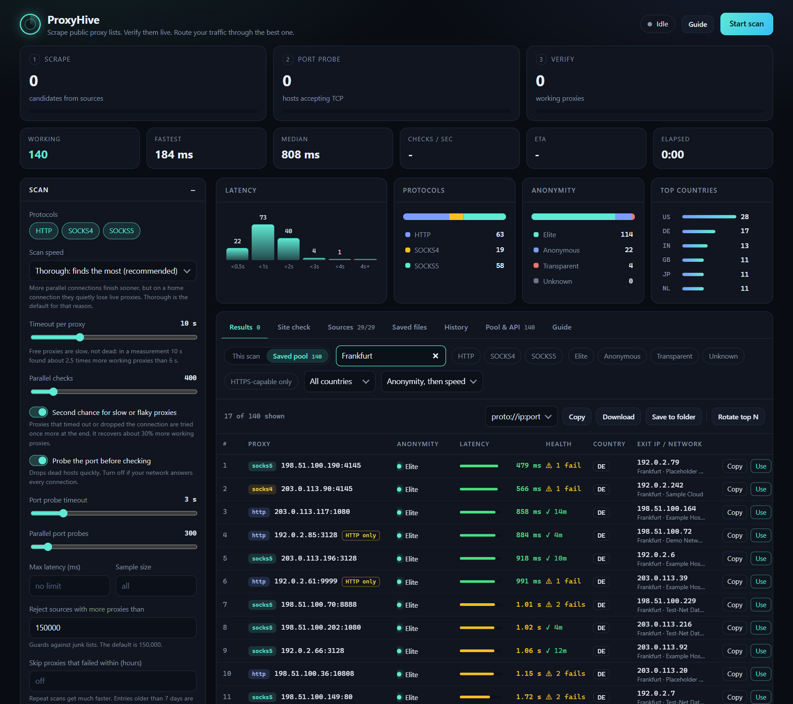
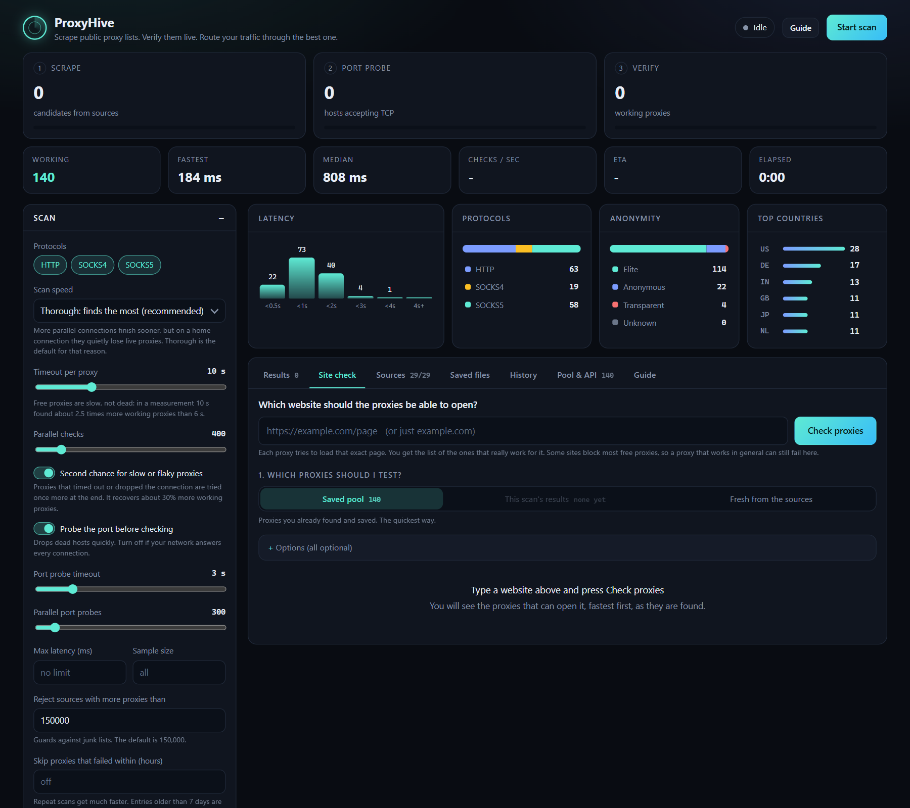
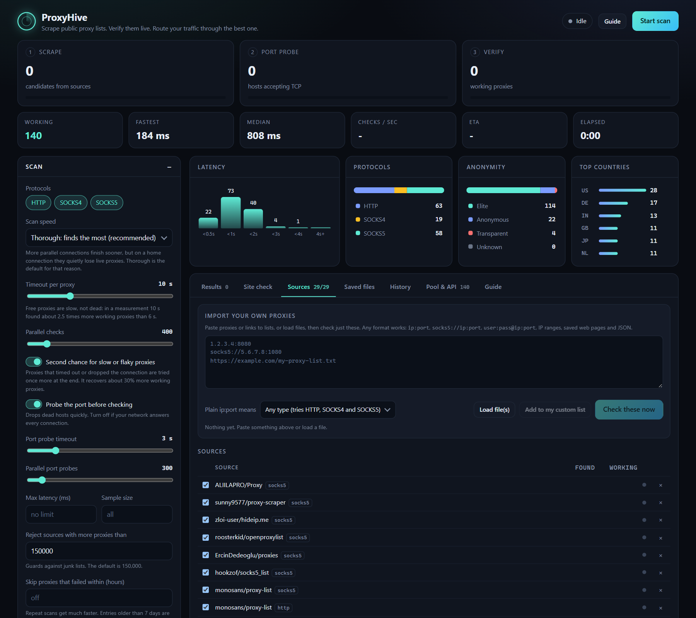
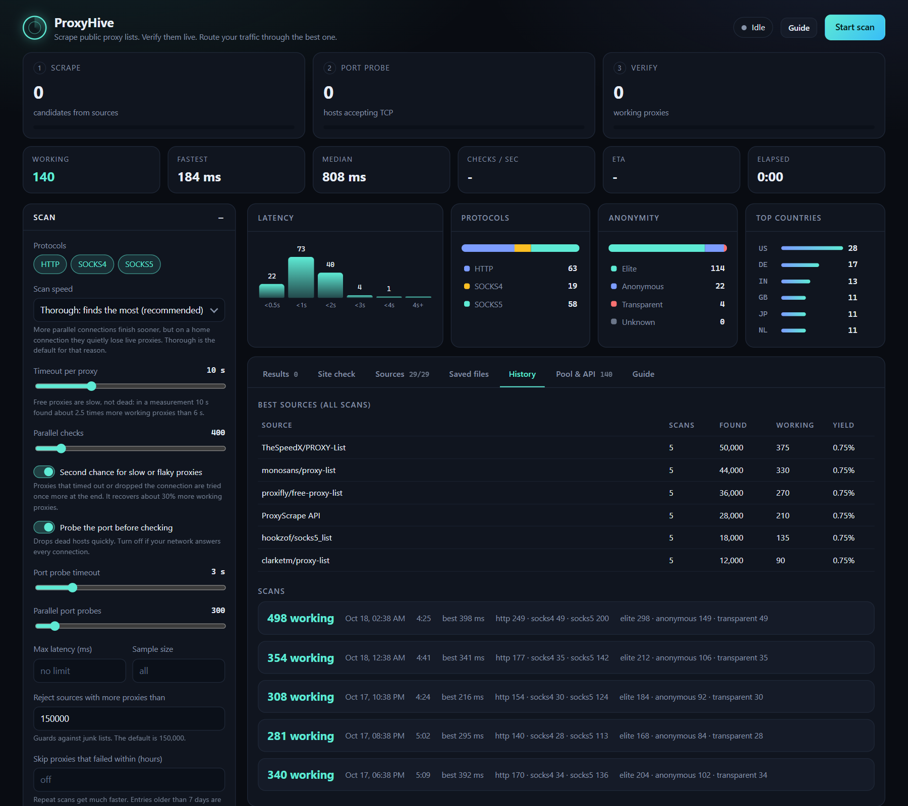
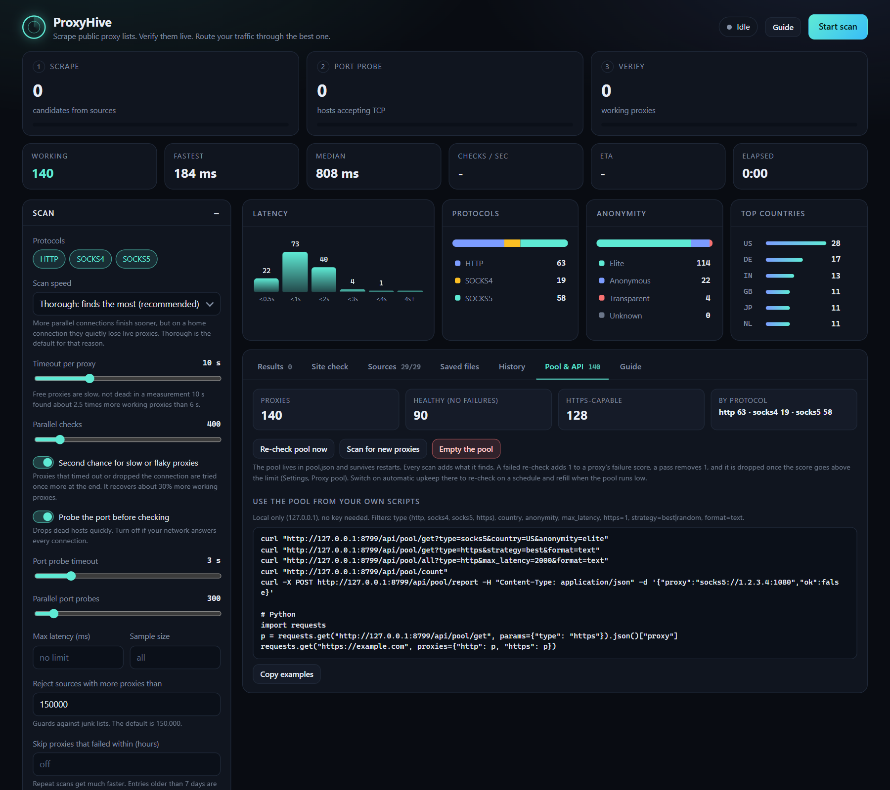
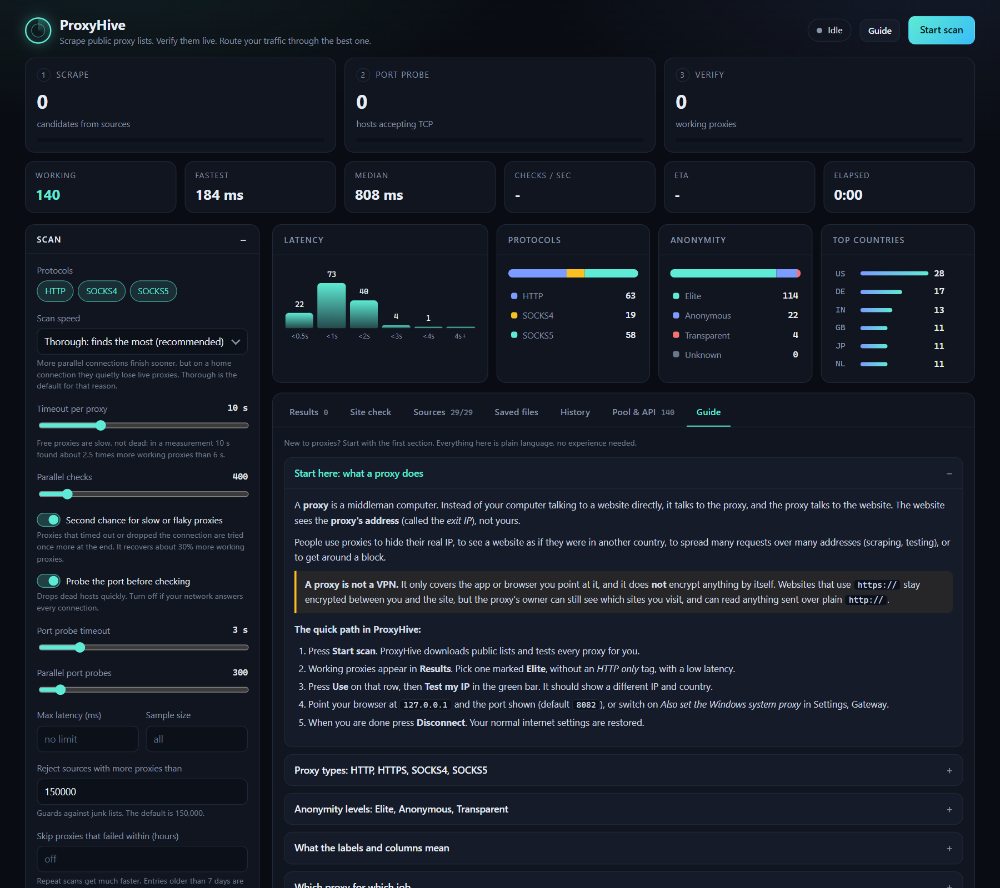

<p align="center">
  
</p>

<p align="center">
  
  
  
  
</p>

<p align="center">
  <b>Scrapes public proxy lists, checks which proxies really work, keeps them in a persistent pool,<br>serves them to your own scripts, and routes your traffic through one to change your IP.</b>
</p>

<p align="center">
  <a href="#get-started">Get started</a> ·
  <a href="#showcase">Showcase</a> ·
  <a href="#features-at-a-glance">Features</a> ·
  <a href="#how-a-proxy-is-judged">How it works</a> ·
  <a href="#command-line">Command line</a> ·
  <a href="CHANGELOG.md">Changelog</a>
</p>

<p align="center">
  
</p>

<p align="center"><sub>Everything shown here is demo data from reserved example addresses. <b>Developer:</b> B3hnamR · <a href="https://t.me/B3hnamR">Telegram</a> · <a href="https://github.com/B3hnamR">GitHub</a></sub></p>

## Features at a glance

| | | |
| --- | --- | --- |
| **Live pipeline**<br>Scrape, port probe and verify run together, so working proxies appear within seconds. | **Honest checks**<br>HTTPS through the proxy, exit IP and country, anonymity level, speed, and extra sites you choose. | **Persistent pool**<br>Every good proxy is scored and kept. Dead ones fade out after a few failed re-checks. |
| **Change your IP**<br>One click on **Use** starts a local gateway. Optionally set the Windows system proxy, with a safe restore. | **Site check**<br>Find out which proxies can open one specific website, such as the site that blocks you. | **Local API**<br>Your own scripts ask `127.0.0.1` for the best proxy by type, country or anonymity. |
| **Bring your own**<br>Paste proxies or links, drop files. Logins, CIDR ranges, HTML tables and JSON are understood. | **Portable app**<br>One `.exe`, no install, its own window and icon. All data stays in the folder it lives in. | **Measured defaults**<br>Speed settings come from real measurements, not guesses. One menu picks Thorough, Balanced or Fast. |

## Showcase

<table>
  <tr>
    <td width="50%"><br><sub><b>Results.</b> Live counters, latency, protocol, anonymity and country charts, and a table that handles tens of thousands of rows.</sub></td>
    <td width="50%"><br><sub><b>Filter and sort.</b> By protocol, anonymity, country, HTTPS, or any text. Copy, export or press <i>Use</i> on a row.</sub></td>
  </tr>
  <tr>
    <td><br><sub><b>Site check.</b> Which proxies can really open the website you care about?</sub></td>
    <td><br><sub><b>Sources.</b> Toggle, add or remove sources, import your own proxies, see each source's yield.</sub></td>
  </tr>
  <tr>
    <td><br><sub><b>History.</b> Past scans and the best sources.</sub></td>
    <td><br><sub><b>Pool and API.</b> The saved pool, upkeep, and ready-to-paste API calls.</sub></td>
  </tr>
</table>

<details>
<summary><b>The built-in Guide for people new to proxies</b></summary>
<br>

</details>

The pictures are regenerated from a demo copy of the app by `python scripts/make_screenshots.py`.

## Get started

**Portable .exe (Windows):** download `ProxyHive.exe` from the Releases page (or build it yourself), then copy `ProxyHive.exe` anywhere. It needs no Python and no install. Double-click it and ProxyHive opens as **its own app window**: no browser tab, no terminal, the usual minimize / maximize / close buttons and the ProxyHive icon. Closing the window quits the app cleanly (a running scan is ended, the gateway is disconnected and your Windows proxy is put back). Everything it saves (settings, pool, results, sources, history, even the window's own small files) goes into the folder the .exe is in, so copying the .exe to a new folder gives you a fresh, self-contained copy. The window uses the Microsoft Edge WebView2 engine, which is part of Windows 11 and recent Windows 10; if it is missing the app tells you where to get it. Messages go to `proxyhive.log` next to the .exe.

```bat
pip install -r requirements-dev.txt
scripts\build_exe.bat    :: creates dist\ProxyHive.exe
```

**From source:**

```bash
pip install -r requirements.txt
python app.py             # the app window (or double-click scripts\start-ui.bat: same, without a terminal)
python app.py --server    # the dashboard in your browser on http://127.0.0.1:8765 (or scripts\start-browser.bat)
python app.py --version   # prints the version
```

Options of the program: no option opens the app window; `--server` runs the dashboard in a terminal and opens your browser instead (`--no-browser`, `--port N` work too); anything else, such as `--limit 3000`, runs the terminal scanner. `PROXYHIVE_PORT` changes the port the app window uses (default 8765).

Set `PROXYHIVE_HOME` to keep the data in another folder.

## Dashboard

- **Streaming pipeline:** scrape, port probe and verify run together, so working proxies show up within seconds.
- **Results list:** handles tens of thousands of rows. Filter by protocol, anonymity, country, HTTPS capability or text (IP, city, network). Sort by anonymity, country, speed, latency, or click any column. Switch between **This scan** and the **Saved pool**.
- **Why proxies failed:** a live breakdown (port timed out, refused, timed out, needs a login, wrong protocol, TLS error, ...) with a hint when a setting would help, for example a longer timeout.
- **Insights:** latency histogram, protocol split, anonymity split, top countries. Click a legend entry or country to filter.
- **Use button on any row:** starts the local gateway so your traffic leaves through that proxy.
- **Export:** copy or download the visible list as `ip:port`, `proto://ip:port`, proxychains config, browser PAC file, CSV, JSON, or your own template.
- **Tabs:** Results, **Site check**, Sources (import your own proxies, toggle/add/remove sources, per-source yield), Saved files (download, re-check), History (past scans and best sources), Pool & API, and a plain-language **Guide** for people new to proxies (proxy types, anonymity levels, which proxy for which job, risks, troubleshooting).
- **Themed dropdowns** everywhere (keyboard friendly: arrows, Enter, Esc, type to jump).
- **Every option is in the sidebar** and saved on the server.

## How a proxy is judged

1. TCP connect to `ip:port` (optional, drops dead hosts fast).
2. HTTPS request through the proxy to the primary test URL (Cloudflare trace by default). Gives latency, exit IP, country. The certificate must be valid, so HTTPS-intercepting proxies fail.
3. **HTTP-only fallback:** an HTTP proxy that refuses HTTPS tunnels but forwards plain `http://` is kept and labelled *HTTP only* instead of being counted as dead. Filter or skip them with *HTTPS-capable only*.
4. Every extra target you picked (Google, Amazon, YouTube, GitHub, Wikipedia, or your own URLs) must load.
5. **Anonymity** (HTTP proxies): a plain-HTTP request to a header-echo page. *Transparent* leaks your IP, *Anonymous* adds proxy headers, *Elite* adds none, *Unknown* could not be tested. SOCKS proxies cannot add headers, so they are Elite unless the exit IP is yours.
6. Optional download speed test (Mbit/s).
7. Optional **city, ASN and organization** from an offline database (see below).

## Why the defaults are what they are (measured, not guessed)

ProxyHive runs on one thread with `asyncio`: scanning waits on the network, not the CPU. In a measurement at 1,000 parallel checks it used 7 to 12% of one core with the event loop lagging about 10 ms, so more threads would not help. What decides how many working proxies you find is how gently you treat your own connection. On a home connection, with the same candidates each time:

| Setting | Result |
| --- | --- |
| Check timeout 6 s, 8 s, 12 s | found 80, about 180, 207 working proxies: free proxies are slow, not dead (default **10 s**) |
| Parallel checks 1,000 / 400 / 100 | about 172 / 222 / 200 found (default **400**: 15 to 20% better than 1,000, and 6 times faster than 100) |
| Parallel port probes 1,500 / 800 / 500 / 300 | 51% / 76% / 91% / 100% of live ports found: a home router drops the burst, silently (default **300**) |
| Probe timeout 2 to 4 s | barely matters (default **3 s**) |
| One extra pass over failures | recovered about 30% more working proxies (**Second chance** is on by default) |

The *Scan speed* menu (Thorough, Balanced, Fast) sets these in one click. Other safeguards: proxies that time out or drop the connection get a second try at the end; one odd proxy can never crash a worker or lose a candidate; port probes close without leaving thousands of half-closed sockets behind; running out of local ports is detected and shown as "Your PC ran out of connections" instead of being blamed on the proxy; big lists are parsed off the main loop so the dashboard never freezes. Settings saved by an older version are upgraded once to these values.

## Sources and parsing

The parser understands far more than `ip:port` text:

- `scheme://ip:port`, `user:pass@ip:port` and the provider style `host:port:user:pass` (a trailing `{note}` is ignored). Proxies with a login are checked and used with it
- CIDR ranges such as `10.20.30.0/24:8080` (up to /16)
- HTML tables with the IP and port in neighbouring cells
- JSON records with `ip`/`host` and `port` fields, plus `protocols`, `username`, `password` (for example the Geonode API)
- a per-source limit (default 150,000) rejects junk lists

`sources.txt` is `<protocol> <url>` per line. Add or remove sources in the dashboard or by hand.

## Import your own proxies

Sources tab, *Import your own proxies*. Paste proxies or **links to lists**, drag files onto the box or press *Load file(s)*, choose what a plain `ip:port` means (any type, HTTP, SOCKS4 or SOCKS5), then **Check these now**. Only your list is checked (settings such as the protocol chips and the dead-proxy cache do not filter it), and the working ones go into the pool. *Add to my custom list* keeps them for every future scan instead. Every file is read as its own document, so JSON files and saved web pages work next to plain text.

## Site check: which proxies can open one specific website?

Site check tab: type an address (`example.com` is enough), pick where the proxies come from (**saved pool**, **this scan's results**, or **fresh from the sources**) and press **Check proxies**. Each proxy tries to load that exact page and you get a live list of the ones that can, fastest first, with their status code. Redirects are followed. Optional: the page must contain some text (catches block pages that still say 200), accept only status 200, timeout, parallel checks, max proxies. The result list has the same Copy / Download / Save / **Use** / **Rotate top N** buttons, so a proxy that works for your site is one click from your browser. It runs as its own session next to the normal scan; starting a new check replaces the one in progress.

## The proxy pool

Every working proxy a scan finds is saved in `pool.json`, so nothing is lost when you restart.

- **Scoring:** a failed re-check adds 1 to a proxy's failure score, a pass removes 1, and it is dropped once the score is above the limit (default 3). A good proxy survives one bad moment; dead ones disappear.
- **Upkeep (off by default):** with *Keep the pool fresh automatically* on, ProxyHive re-checks the pool every N minutes and runs a scan when it falls below the minimum size. It uses bandwidth in the background, hence off by default.
- **Re-check now / Scan for new / Empty** buttons in the Pool & API tab.

## Local API for your scripts

Listens on `127.0.0.1` only. No key needed.

```bash
curl "http://127.0.0.1:8765/api/pool/get?type=socks5&country=US&anonymity=elite"
curl "http://127.0.0.1:8765/api/pool/get?type=https&strategy=best&format=text"
curl "http://127.0.0.1:8765/api/pool/all?type=http&max_latency=2000&format=text"
curl "http://127.0.0.1:8765/api/pool/count"
curl -X POST http://127.0.0.1:8765/api/pool/report -H "Content-Type: application/json" -d '{"proxy":"socks5://1.2.3.4:1080","ok":false}'
curl -X POST http://127.0.0.1:8765/api/pool/delete -H "Content-Type: application/json" -d '{"proxy":"socks5://1.2.3.4:1080"}'
```

Filters: `type` (http, socks4, socks5, https), `country` (comma list), `anonymity` (comma list), `max_latency`, `min_speed`, `max_fails`, `https=1`, `strategy=random|best`, `format=json|text`, `limit` (for `/all`). `/get` returns `{"proxy": "socks5://ip:port", ...}`; proxies that need a login include it in the URL. Reporting failures lets your scripts help the pool score proxies.

```python
import requests
p = requests.get("http://127.0.0.1:8765/api/pool/get", params={"type": "https"}).json()["proxy"]
requests.get("https://example.com", proxies={"http": p, "https": p})
```

## Changing your IP (gateway)

Press **Use** on a row, or **Rotate top N**. ProxyHive listens on a local port (default `127.0.0.1:8082`, also the port used for the Windows system proxy) and forwards everything through the chosen proxy (HTTP, SOCKS4 or SOCKS5 upstream). **Test my IP** in the green bar confirms the outgoing IP changed.

Point your browser or app at that port as an **HTTP proxy**, or tick *Also set the Windows system proxy*. The previous Windows proxy settings are saved first and restored on Disconnect, on exit, and on the next start if the app crashed. Restoring only happens if the proxy is still the one ProxyHive set, so it never overwrites a change made by a VPN or proxy app in the meantime. ProxyHive also asks a separate process whether Windows really received the setting. Run the app from `ProxyHive.exe` or `scripts\start-ui.bat` in a normal window: a copy started inside a sandboxed host (such as an app's built-in preview pane) has its registry writes silently redirected, so it cannot change Windows, and it tells you so. **Test my IP** checks both the gateway and the browser you are using, so you can see whether the browser really goes through it.

- **Rotation:** round-robin or random; switch every connection, every N requests or every N seconds.
- **Self-healing:** after N errors in a row a proxy is dropped and replaced from the pool. Plain-HTTP requests that get no answer are retried on another proxy.
- **HTTP-only proxies** are used for plain `http://` sites and skipped for HTTPS.
- **Sharing:** set *Who can use the gateway* to your network to let other devices use it. This requires a username and password.

Free proxies see your traffic. Do not log in to anything important through them.

## Location data (city, ASN, organization)

Optional. Press *Download databases* in the dashboard (about 65 MB, free [DB-IP Lite](https://db-ip.com) data under CC BY 4.0, no account). Nothing is downloaded until you press the button. After that every lookup is offline, with no per-proxy API calls. Files go to the `data` folder next to the program.

## Save options

Formats, filters (protocol, anonymity, HTTPS-capable, country, max latency, max count), sort order, one file or split by protocol/country/anonymity, a template with `{proto} {host} {port} {user} {pass} {country} {city} {asn} {org} {latency} {anonymity}`, optional user/password, timestamps, and auto-save after each scan. Re-checking a saved list overwrites it with the survivors if auto-save uses the same file name.

## Command line

```bash
python app.py                                # scrape, check, save to results/
python app.py --anonymity --speed      # add anonymity and speed tests
python app.py --extra-url https://www.google.com/generate_204
python app.py -i mylist.txt --protocols socks5 --sort anon_country
ProxyHive.exe --limit 3000                   # the .exe accepts the same options
```

Other flags: `-t/--timeout`, `-c/--concurrency`, `--connect-timeout`, `--no-prefilter`, `--url`, `--no-http-only`, `--max-per-source`, `--max-latency`, `--limit`, `--top`, `--server`, `--port`, `--no-browser`, `--version`. Ctrl+C stops early and still saves.

## Safety notes

- High concurrency can overwhelm cheap home routers (their connection table fills up and your internet stalls). The dashboard warns above 1,000 parallel checks / 1,500 probes. Lower them if that happens.
- The dashboard and the API listen on `127.0.0.1` only and reject requests from other websites.
- A .exe built with PyInstaller is sometimes flagged by antivirus software. Building it yourself from this source avoids that uncertainty.

## Tests

```bash
pip install -r requirements-dev.txt
python -m pytest                # 55 tests, no internet needed
```

They cover the parser, anonymity and error classification, pool scoring, the gateway (rotation, dropping, retry, password, HTTP-only), whole scans with local fake proxies (exact accounting, second chance, crash-proof workers), import, Site check, and the API.

## Project layout

| Path | Purpose |
| --- | --- |
| `app.py` | launcher (`python app.py`) and the entry point `ProxyHive.exe` is built from |
| `proxyhive/__init__.py` | the version number (single source: the exe, the page footer, `--version` and the package all read it) |
| `proxyhive/cli.py` | what the program does with its command-line options |
| `proxyhive/desktop.py` | the app window: the dashboard inside a native window, clean shutdown |
| `proxyhive/engine.py` | scraping and checking engine, terminal UI |
| `proxyhive/server.py` | dashboard backend and API |
| `proxyhive/pool.py` | persistent pool with scoring |
| `proxyhive/gateway.py` | local forwarding proxy, Windows system proxy |
| `proxyhive/geo.py` | offline city/ASN lookup and downloader |
| `proxyhive/exports.py` | filtering, sorting, formats, saving |
| `proxyhive/config.py` | validated settings, dead cache, history |
| `proxyhive/paths.py` | where data lives (portable) |
| `web/index.html` | the dashboard page |
| `assets/` | icon (`.ico`, `.png`, `.svg`) |
| `scripts/` | `build_exe.bat`, `make_version_info.py`, `make_icon.py`, `make_screenshots.py`, `start-ui.bat`, `start-browser.bat` |
| `docs/` | README banner and the screenshots/tour |
| `tests/` | the test suite |
| `sources.txt` | default sources, `<protocol> <url>` per line |

Your own data (`settings.json`, `pool.json`, `results/`, ...) is written next to the program and is ignored by git.

## Releasing

Change `__version__` in `proxyhive/__init__.py`, add an entry to `CHANGELOG.md`, run the tests, run `scripts\build_exe.bat`, tag `vX.Y.Z` and attach `dist\ProxyHive.exe` to a GitHub release.

## Credits

ProxyHive by **B3hnamR** · Telegram <https://t.me/B3hnamR> · GitHub <https://github.com/B3hnamR>
